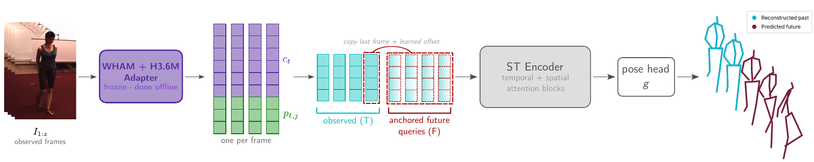

# Improving 3D Human Motion Forecasting from RGB Videos using Auxiliary Tasks

<p align="center">
  
</p>

This repository contains the code and experiments of my Master's Thesis at the University of Bonn.

**Goal:** given an RGB video of a person, predict how their 3D pose will move in the next frames
(15 observed frames → 25 future frames).

We start from an autoregressive baseline (PHD) and improve it by:
- testing newer pre-trained feature extractors (HMR, HMR 2.0, WHAM), and
- replacing its stacked 1D convolutions with a spatio-temporal transformer (MotionST).

On top of MotionST, we study whether **auxiliary tasks** (masking joints or frames of the input during training) improve the forecasts.

## Quick overview

| Step | What you do | Section |
| :--: | ----------- | ------- |
| 1 | Set up the conda environment | [Installation](#1-installation) |
| 2 | Download the pre-trained weights | [Pre-trained weights](#2-pre-trained-weights) |
| 3 | Prepare the datasets | [Datasets](#3-datasets) |
| 4 | Extract the features once | [Feature extraction](#4-feature-extraction) |
| 5 | Train and test the models | [Models](#5-models) |

### Repository structure

```text
config/     YAML configs (Human3.6M, short and long horizon)
dataset/    data loading, feature extraction, WHAM adapters
models/     PHD, MotionST, MotionSTAR, adapters and backbones
scripts/    bash scripts to run each step
src/        training / testing entry points
utils/      metrics (MPJPE), DDP helpers, conversion tools
visualize/  3D and qualitative plots
figs/       figures used in this README
```

> **Note:** run every command from the root of the repository, with `export PYTHONPATH=.`.
> The scripts in `scripts/` contain paths from our cluster; edit the paths at the top of each script before running it.

---

## 1. Installation

**Requirements:** Linux, an NVIDIA GPU, and conda.

`scripts/setup_thesis_env.sh` restores the `thesis` conda environment from a packed archive (`thesis_env.tar.gz`, made with `conda-pack`) and clones [WHAM](https://github.com/yohanshin/WHAM) (with ViTPose) into `~/WHAM`.
Place `thesis_env.tar.gz` in the folder you run the script from:

```bash
bash scripts/setup_thesis_env.sh
conda activate thesis
```

The script also sets `TORCH_FORCE_NO_WEIGHTS_ONLY_LOAD=1` in the environment, so that PyTorch can load the older checkpoints.

> **Note:** run it on a machine that does not have `~/WHAM` yet, otherwise `git clone` fails and the script stops.

## 2. Pre-trained weights

We use feature extractors from three pre-trained Human Mesh Recovery (HMR) models.
Create one folder per model:

```bash
mkdir -p models/{hmr,hmr2,wham}
```

**HMR** ([repository](https://github.com/akanazawa/hmr))

```bash
wget -O models/hmr/models.tar.gz https://people.eecs.berkeley.edu/~kanazawa/cachedir/hmr/models.tar.gz
tar -xf models/hmr/models.tar.gz -C models/hmr
```

**HMR 2.0** ([repository](https://github.com/shubham-goel/4D-Humans))

```bash
wget -O models/hmr2/hmr2_data.tar.gz https://www.cs.utexas.edu/~pavlakos/4dhumans/hmr2_data.tar.gz
tar -xf models/hmr2/hmr2_data.tar.gz -C models/hmr2
```

**WHAM** ([website](https://wham.is.tue.mpg.de/))

Download the weights from the WHAM website or from Google Drive:

```bash
wget -O models/wham/wham_data.zip 'https://drive.google.com/uc?id=1i7kt9RlCCCNEW2aYaDWVr-G778JkLNcB&export=download&confirm=t'
unzip models/wham/wham_data.zip -d models/wham
```

> **Note:** Google Drive sometimes returns an HTML page instead of the file.
> If `unzip` fails, download the file manually in the browser.

When you are done, you should have:

```text
models/
├── hmr/
├── hmr2/
└── wham/
```

## 3. Datasets

We use two datasets: [Human3.6M](http://vision.imar.ro/human3.6m/description.php) and [3DPW](https://virtualhumans.mpi-inf.mpg.de/3DPW/).

**Human3.6M.** We get the 2D and 3D ground truth with the
[VideoPose3D preprocessing script](https://github.com/facebookresearch/VideoPose3D/blob/main/data/prepare_data_h36m.py):

```bash
python prepare_data_h36m.py --from-source-cdf /path/to/human3.6m
```

This creates two files:
- `data_3d_h36m.npz`: 3D joint positions in meters (world space)
- `data_2d_h36m_gt.npz`: 2D joint positions in pixels, for all 4 cameras (used to crop each frame around the person)

We use subjects **S1, S6, S7, S8, S9** for training, **S11** for validation and **S5** for testing.
The videos are downsampled by 2 (50 → 25 fps).

**3DPW.** Download the dataset from the official website. The feature extraction script reads the sequence files and images directly from the 3DPW root folder.

## 4. Feature extraction

Running the feature extractors during training is slow.
So we run them **once**, save the features, and train on the saved features.

Open `scripts/extract_features.sh`, set the extractor, the checkpoint and the paths, then run:

```bash
bash scripts/extract_features.sh h36m   # runs dataset/feats.py
bash scripts/extract_features.sh 3dpw   # runs dataset/feats_3dpw.py
```

We compare four feature extractors (details in the thesis):

| `EXTRACTOR` | Model | Feature size |
| ----------- | ----- | :----------: |
| `resnet_v2` | HMR (ResNet-50) | 2048 |
| `hmr2_vit_mean` | HMR 2.0 ViT-H, mean-pooled | 1280 |
| `hmr2_crossattn` | HMR 2.0 cross-attention token | 1024 |
| `wham` | WHAM (512 context + 17 × 3 joints) | 563 |

**Extra step for WHAM only.** WHAM outputs joints in the COCO-17 format, which does not match our ground truth.
A small adapter converts them to the H3.6M skeleton (17 joints) or the SMPL skeleton (24 joints, for 3DPW).
`scripts/wham_adapter.sh` first trains the adapter (`src/train_h36m_adapter.py` or `src/train_smpl_adapter.py`) and then rewrites the features with it (`dataset/wham_h36.py` or `dataset/wham_3dpw.py`):

```bash
bash scripts/wham_adapter.sh h36m
bash scripts/wham_adapter.sh 3dpw
```

For Human3.6M the features keep 563 dimensions.
For 3DPW they grow from 563 to 584 dimensions (512 context + 24 × 3 joints).

## 5. Models

All models are trained with `torchrun` (multi-GPU with DDP) and log to [Weights & Biases](https://wandb.ai/).
Use `--wandb_mode disabled` to turn logging off.
The test mode reports the MPJPE (mm) of the reconstructed past frames and of each future horizon.

### Baseline: PHD

Our version of ["Predicting 3D Human Dynamics from Video"](https://arxiv.org/pdf/1908.04781) (`models/phd_model.py`).
It is trained in two phases:
1. Learn to reconstruct the 3D pose: `f_movie` + `f_3D` (`src/train_phd_ddp.py`).
2. Freeze `f_3D` and learn to forecast future poses: `f_movie` + `f_AR` (`src/train_phd_ddp2.py`), with a curriculum that increases the number of predicted steps up to 25.

`scripts/train_phd_example.sh` runs phase 1, phase 2 and the test, one after the other.
At the top of the script, choose the features: WHAM (`LATENT_DIM=563`) or HMR ResNet (`LATENT_DIM=2048`).

```bash
bash scripts/train_phd_example.sh
```

### Proposed method: MotionST

A spatio-temporal transformer (`models/motionst.py`, trained with `src/train_motionst.py`), shown in the figure at the top.

- The past frames are tokens; the future frames are **learned queries**, anchored on the last observed frame.
- Past and future tokens go through the same encoder, which alternates **temporal** attention (each joint over time) and **spatial** attention (the joints of one frame).
- A pose head maps each token to a 3D joint.

Unlike PHD, MotionST is trained in **one phase**: it reconstructs the past frames and predicts the future frames at the same time.

```bash
bash scripts/train_motionst_example.sh
```

To test, run the same command with `--mode test`.
Useful options of `src/train_motionst.py`:

| Option | Effect |
| ------ | ------ |
| `--feat_dim` | size of the input features (563 for WHAM, 1280 / 1024 for HMR 2.0, 2048 for ResNet) |
| `--wham` | the features are WHAM features; the joints are embedded directly |
| `--context_only` | with `--wham`: use only the 512-d context, drop the joints |
| `--joints_only` | with `--wham`: use only the joints, drop the context |
| `--dataset h36m\|3dpw` | dataset to train / test on |
| `--viz` | save qualitative videos during testing |

### Case study: auxiliary tasks

Does making the task harder during training help the model?
During training only, we corrupt the WHAM input, and the model must still predict the correct pose.
This follows AuxFormer and needs the WHAM features from step 4.

| Task | What is corrupted | Options |
| ---- | ----------------- | ------- |
| `joint` | random joints are masked | `--lambda_aux_joint`, `--aux_joint_ratio` |
| `frame` | all joints of random past frames are masked | `--lambda_aux_frame`, `--aux_frame_ratio`, `--aux_frame_mask_context` |

Turn them on with `--aux`, and choose the tasks with `--aux_tasks joint`, `--aux_tasks frame` or `--aux_tasks both`.

`scripts/ablation_seeds.sh` runs the full ablation on Human3.6M: a baseline without auxiliary tasks, joint masking (ratio 0.1) and frame masking (ratio 0.5), each over 5 seeds.
The three configurations run in parallel on three GPU pairs.
At the end, it prints the mean ± std over the seeds and the difference to the baseline on the same seed.

```bash
bash scripts/ablation_seeds.sh   # takes many hours: run it inside tmux
tail -f logs/ablation_multiseed_*/progress.log
```

If it stops, run it again: finished runs are skipped, and unfinished ones resume from their last checkpoint.

### Alternative architecture: MotionSTAR

An autoregressive version of MotionST (`models/star.py`): the same spatio-temporal encoder, followed by a decoder that predicts the future frames one by one.

*Training script coming soon.*

---

## Author

| [Luísa Ferreira](https://ferreiraluisa.github.io/luisaferreira/) |
| :------------------------------------------------------------: |
| MSc Student, University of Bonn, Germany |
| <s26ldeso@uni-bonn.de> |

## Acknowledgements

I would like to thank Fatemeh Jabbari and Marius Bock for their guidance and support as advisors of this thesis.
Claude Opus 5.5 (Anthropic) helped write the bash scripts and edit the documentation in this repository.

---

### Enjoy it! :smiley: